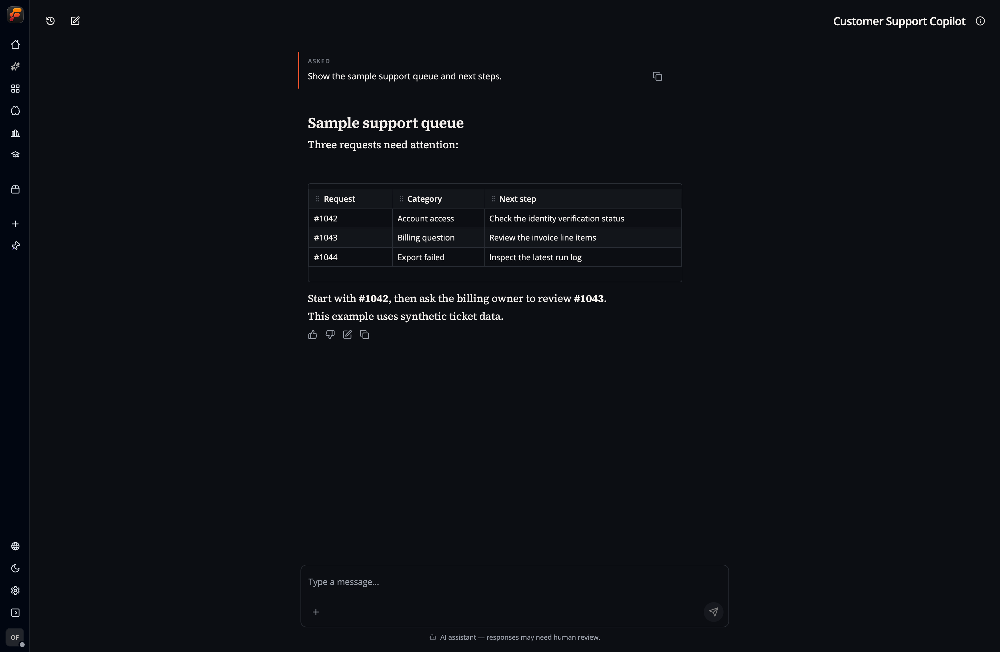

Add a **Chat UI** event to an app to expose its flow as a chat interface. See [Events](/apps/events/) for event setup.



This capture uses a synthetic conversation to show the message layout, table,
response controls, and composer. It does not show a live model run.

## Starter suggestions

Each Chat UI event has its own starter suggestions. In the event configuration,
open **Tools & starters** and edit **Example Messages**. Press Enter after each
message, then save the event. Use prompts that fit the app's purpose.

The welcome screen initially shows up to four suggestions and filters the configured list
as the user types. Selecting a suggestion fills the message box so the user can
edit it before sending. Leave the list empty to hide suggestions. Events with
no configured messages also hide suggestions.

## Reply to a message or react with an emoji

Choose **Reply** on an older model message to quote it above the composer. Write
your answer and send it to start a new run. Remove the quote from the composer
if you want to send an ordinary message instead.

Choose **Add reaction** on a message to select an emoji. Selecting one of your
existing reactions removes it. Adding or removing a reaction sends a new user
turn and starts a run, so the model can respond to the action. The conversation
keeps the referenced message beside the reply or reaction.

The model receives the referenced message's ID, role, and visible text together
with the new reply, or the literal emoji and whether it was added or removed.
This reference is saved separately from the normal history window, so a reply
to an older message keeps its context even when that message is outside the
configured history limit. References contain up to 16,000 characters of visible
text and mark any truncation. They describe attachments without resending their
contents.

## Follow a run while browsing

Open **Activity** to see runs in progress, requests for input, and recent results.
Use **Respond** to answer a question, **Stop** to cancel a run, or **Open** to return
to its conversation. Finished runs stay in the tray until you dismiss them.

In browsers that support SharedWorker, tabs on the same site and signed-in
profile share active runs and chat history. You can close the tab that started
a run while another connected tab stays open. Replies to the same question are
coordinated across tabs, so answering twice sends only the first accepted reply.
A request to read or use a page or widget still needs that surface open in a tab.

Browsers without SharedWorker keep execution in the initiating tab. Keep that
tab open until its run finishes. Closing every connected tab or closing the
browser ends the browser connection; saved chat history remains available.

## Main widget

A conversation can keep one widget beside its messages, such as a browser, a
preview, or a dashboard. Drag the divider to resize it. The pane controls let
you maximize it, restore the split view, or collapse it completely. Use
**Show main widget** to reopen a collapsed pane. These controls keep the widget
mounted, so an embedded browser does not reload when the layout changes.

On phones, the chat uses the full screen. Tap **Show main widget** to open the
widget in a dialog, then close the dialog to return to the conversation.

To control the pane from a flow:

1. Create a widget instance with **Instantiate Widget**.
2. Connect its **Element Ref** to **Set Main Widget** under **Events/Chat**.
   Set a title and choose `open`, `collapsed`, or `maximized` for its desktop display.
3. Use the existing element update nodes with that instance's references to
   change its content. To exchange it for another widget, connect a different
   instance to **Set Main Widget**.
4. Use **Clear Main Widget** to remove it from the conversation.

The pane's latest widget and streamed updates are saved with the conversation.
Reopening the conversation restores that state. Starting a new conversation
starts with no main widget. **Push Widget** and **Push Widgets** still place
widgets inside individual messages.

## Appearance

The event configuration provides:

- **Background image** selected from app storage or provided as an external URL.
- **20 theme presets** ranging from professional layouts to Cyberpunk, Typewriter, Neon Grid, and animated Aurora Glass styles. Presets follow the app's current light or dark mode.
- **Custom CSS**, edited with the built-in Monaco editor.
- **AI disclosure text** that is always visible so people know they are chatting with AI. State that the responses come from AI and explain any limits relevant to the task.

Selecting a theme copies its complete CSS into the editor. Change any part of
that CSS and the theme selector immediately changes to **Custom**. Selecting a
preset again replaces the editor contents with that preset's canonical source.

The built-in set includes Flow Like, Executive, Editorial, Typewriter, Neon
Grid, Aurora Glass, Green Screen, Blueprint, Swiss, Nordic, Brutalist, Art Deco,
Solarpunk, Noir Cinema, Pixel Arcade, Cyberpunk, Synthwave Sunset, Oceanic,
Candy Pop, and Zen Garden.

When you select a background from app storage, the event keeps its stable
storage path. Chat UI requests a temporary signed URL when it loads, so signed
credentials are never saved in the event configuration.

## Custom CSS

Custom CSS is sanitized and scoped to this Chat UI. Use `:root` for chat-wide variables; here, `:root` means **this chat only**, not the app or document root.

```css
:root {
  --primary: #7c3aed;
  --fl-chat-content-width: 52rem;
  --fl-chat-message-radius: 1.25rem;
  --fl-chat-background-overlay: rgb(0 0 0 / 35%);
}

[data-fl-chat-message="assistant"] {
  border: 1px solid var(--border);
}
```

### CSS variables

| Variable | Controls |
| --- | --- |
| `--background` | Base chat background color |
| `--foreground` | Default text color |
| `--primary` | Primary/accent color |
| `--primary-foreground` | Text and icons on the primary color |
| `--muted` | Muted surface color |
| `--muted-foreground` | Text and icons on muted surfaces |
| `--border` | Default border color |
| `--fl-chat-content-width` | Maximum width of chat content |
| `--fl-chat-message-radius` | Message bubble corner radius |
| `--fl-chat-surface-background` | Welcome and conversation surface background |
| `--fl-chat-composer-background` | Composer background color |
| `--fl-chat-user-message-background` | User message background color |
| `--fl-chat-user-message-foreground` | User message text color |
| `--fl-chat-ai-message-background` | Assistant message background color |
| `--fl-chat-ai-message-foreground` | Assistant message text color |
| `--fl-chat-disclosure-background` | AI disclosure background color |
| `--fl-chat-disclosure-foreground` | AI disclosure text color |
| `--fl-chat-background-overlay` | Overlay rendered over the background image |
| `--fl-chat-background-overlay-strong` | Stronger overlay toward the lower page |
| `--fl-chat-background-size` | Background image sizing, such as `cover` or `contain` |
| `--fl-chat-background-position` | Background image position |
| `--fl-chat-pad-bottom` | Extra space below the chat content |

### Stable selectors

Use these stable hooks for more targeted styling:

- `[data-fl-chat-surface]`
- `[data-fl-chat-welcome]`
- `[data-fl-chat-welcome-panel]`
- `[data-fl-chat-suggestion]`
- `[data-fl-chat-messages]`
- `[data-fl-chat-message="user"]`
- `[data-fl-chat-message="assistant"]`
- `[data-fl-chat-composer]`
- `[data-fl-chat-ai-disclosure]`
