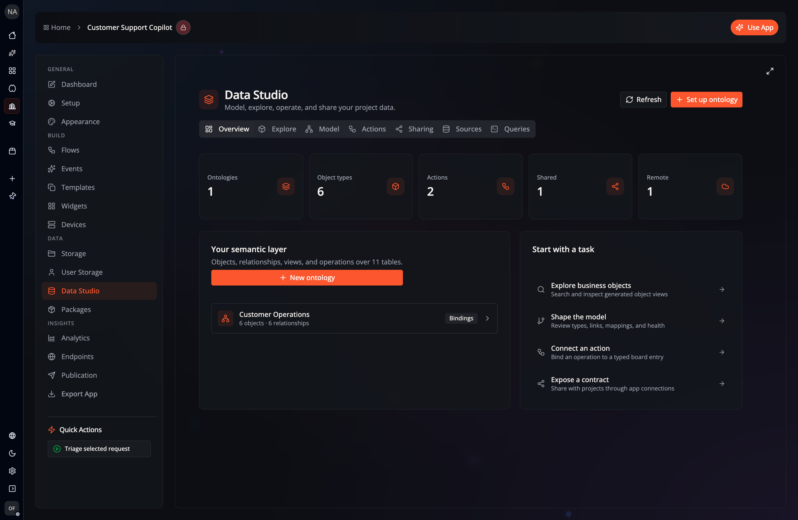
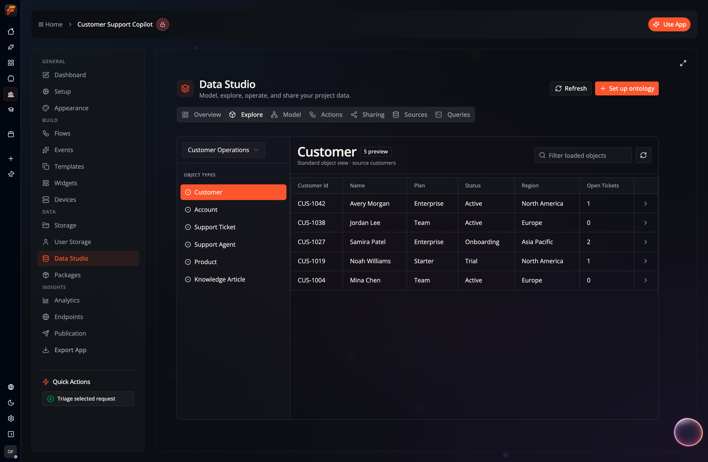
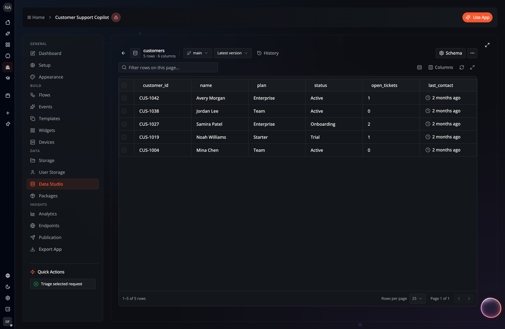

Enable [Developer Mode](/start/developer-mode/) to see this workspace in the App navigation.

**Data Studio** is an app's home for structured data: native tables created directly or by flows, and the [ontology](/topics/ontology/overview/) — a semantic layer of object types, relationships, and governed actions — you build on top of them. Open it from an app's **Data → Data Studio** view.



## Tabs

| Tab | What it's for |
|-----|---------------|
| **Overview** | At-a-glance counts (ontologies, object types, actions, shared, and remote) and shortcuts into the other tabs |
| **Explore** | Browse objects of each type in a preview table and open an object's inspector — its views, available actions, and editable properties |
| **Model** | Create, rename, and delete ontologies; review object types and relationships; open the data graph |
| **Actions** | Define governed operations that run on an object type |
| **Sharing** | Expose ontologies to connected projects, and install ontologies published by others |
| **Sources** | Create and inspect project or personal native tables, plus object types from installed remote ontologies |
| **Queries** | Run SQL over native tables, local ontologies, or installed remote contracts and view the result as a table, chart, relationship graph, or JSON |
| **Forecast** | Run a Forecasting Bit against native tables, or open a saved prediction |

## Explore ontology objects

The **Explore** tab turns ontology mappings into searchable business objects. Select an ontology and object type on the left, filter the loaded preview, and open any row for its configured highlights, remaining properties, and governed actions.



### Edit object properties

You can change the stored property values of an object without leaving Data Studio:

- **In the object sheet**: open an object, click **Edit**, change one or more fields, and click **Save Changes** (or press Ctrl/Cmd+Enter). A changed field is outlined and can be reverted on its own; **Set empty** (**Clear** for dates) empties a field that allows empty values. If you close the sheet with unsaved changes, Data Studio asks before discarding them. While a save is in progress, the sheet stays open until it finishes.
- **In the ontology graph**: open an ontology's graph view, select an object, and use the pencil next to a property in the inspector to edit it in place.

Relationship properties can be edited in the graph inspector too, but only for relationships stored in their own join table. A relationship that is a column on an object's table says which object stores its values and, when that object is on the graph, offers a button that opens it so you can edit those values there.

Some values stay read-only, marked with a lock that explains why:

- Columns that identify an object or link it to another object.
- Geometry, binary, vector, list, and nested values.

Each save checks that the fields you changed still hold the values you started from. If someone else changed one of those fields in the meantime, nothing is written: Data Studio shows a conflict message and the current values, keeps your edits, and your next save replaces the new values. Changes others made to fields you did not edit are kept.

Editing needs the **Write Files** or **Write Database** permission on the project; without it the Explore tab says objects are read-only. Objects from installed remote ontologies are always read-only.

Edits change the stored values directly. They do not run the ontology's governed actions or the rules those actions enforce, so use an action when a change needs that workflow.

## Native tables

The **Sources** tab lists project and personal relational tables. Tables may be created directly in Data Studio or by flows that persist structured results. A table created by a flow takes its column types from its [first write](/topics/datascience/loading/#column-types-from-the-first-write). Open a source to inspect its rows, schema, and indexes:



Use [Choosing a Lance index](/topics/datascience/lance-indexes/) before adding an index. It maps the repeated query to the appropriate index and explains which algorithms work on native Lance tables and which are supported
by a remote LanceDB connection.

## The ontology layer

On top of those tables you can define an **ontology**: object types, link types, object views, and governed actions — a knowledge graph you can search, traverse, visualize, and act on without moving any data.

- [Ontology & Knowledge Graph](/topics/ontology/overview/) — object types, link types, the graph explorer, and actions.
- [Shared & Remote Ontologies](/topics/ontology/remote/) — expose an ontology to connected projects and install ontologies published by others.

## Query and visualize

The **Queries** tab provides one SQL workbench for project tables, personal tables, local ontology overlays, and installed remote contracts. Local statements can be saved as stored queries or — when they have no parameters — reusable views. Remote statements are read-only previews and cannot be saved in the consuming project.

Results can be inspected as a data table, a configurable chart, a relationship graph, or raw JSON. The workbench preserves the query and visualization configuration together when you save a local query.

## Forecast table data

Add a [Forecasting Bit](/topics/datascience/ml/#forecast-with-pretrained-time-series-models) to your active profile to reveal the **Forecast** tab. New predictions open a setup wizard. Choose a project or personal data scope, select a table or SQL query, map its columns, then choose a model and forecast horizon. The final step lets you review the configuration before running it. **Edit setup** returns to those settings without discarding the previous result.

For data spread across several tables, switch to SQL and join them in one read-only query. SQL runs through DataFusion against tables in the selected scope.

Preview the input and map its timestamp, numeric targets, and optional series identifier. Each series needs evenly spaced timestamps. Use SQL to aggregate or align observations before forecasting; duplicate timestamps and irregular intervals produce an error. Numeric covariates are additional inputs, such as promotions or whether a store is open. Their availability depends on the selected model. Known future covariates also need a future query with one row per forecast step and series.

Timestamp columns can contain native dates, date text, or Unix epochs. The wizard previews up to 500 rows and shows their UTC interpretation. Automatic detection recognizes seconds, milliseconds, microseconds and nanoseconds for contemporary Unix dates, plus ISO 8601, common year-first dates, month names and RFC 2822 dates. Choose an explicit unit for short epochs near 1970, or **Day first** or **Month first** for ambiguous dates such as `04/05/2026`. Dates without a timezone use UTC. Forecasting requires whole-millisecond precision and validates every row when it runs.

Metrics and covariates can also contain numeric text such as `"62.43"` or `"1.2e3"`. The wizard labels these columns **numeric text**. Conversion applies only to the forecast; it does not alter the source table. Currency symbols, thousands separators, blank strings and invalid values must be cleaned in the source query. Null target values remain missing observations. If **Next** is disabled, the message beside it identifies the missing selection or invalid format.

Set the forecast horizon and run the model. New predictions open in **Outlook**, with historical evaluation turned off by default. The chart places observed values and forecasts on a shared timeline, using your theme's chart colors. New predictions use each checkpoint's native output, including a quantile band when available. TinyTimeMixer displays a mean **Point forecast only**, without a band. Saved predictions retain any explicitly requested quantiles. Covariate tracks share the same timeline; changing their selection requires a new run.

Drag across the plot or move the time-range handles to inspect a smaller window. Zoom buttons adjust the visible range, and **Reset zoom** restores all dates. **Focus forecast** brings the prediction period into view. Choose **Full screen** for more space and press **Escape** to return. Zooming also aligns the covariate tracks and leaves the forecast results unchanged.

Supported models include Timestral, Chronos-2, Toto 2, TimesFM 2.5 and IBM Granite TinyTimeMixer. TimesFM 2.5 and the supported TinyTimeMixer checkpoints accept one target per series and no covariates. TimesFM supports horizons up to 1,024 steps. The included TinyTimeMixer R2 MSE checkpoint predicts up to 96 steps and targets minutely to hourly observations; provide 512 historical steps where possible. Other TinyTimeMixer variants have different requirements. Choose the model's supported history range in SQL if your table contains more rows per series than it accepts.

### Forecast machines from one table

Set **Series ID** to a column such as `machine_id` to forecast each machine independently in one run. Each group needs one row per timestamp, with values in numeric target columns. If several sensors share a machine and timestamp, use SQL to aggregate their readings or place them in separate target columns first. Multiple targets require a model with joint-target support. A composite group such as site plus machine needs one unique derived ID column in SQL.

For an overall forecast, aggregate the history before running the model. For example, this query produces a total at each aligned timestamp; map `total_power` as the target and choose **Single series**:

```sql
SELECT "time", SUM("power") AS total_power
FROM sensors
GROUP BY "time"
```

The chart and saved prediction viewers show one selected target and series at a time. Use the series selector to inspect another machine; simultaneous group overlays and highlighting are not available. Saving keeps every group's results. An overall forecast and independent machine forecasts are separate runs. Adding machine quantiles together does not give a valid quantile band for the overall total.

Each series can have its own time interval and last observed timestamp. The horizon is the same number of steps for every series. Future covariates must contain exactly that many rows for each group, continuing its own interval with matching ID types. Extra groups, missing groups and missing future values are rejected.

### Evaluate a historical window

Enable **Evaluate on held-out data** and choose how many observed steps to predict. After a run, select **Holdout** to compare predictions with actual values. Drag the holdout window through the timeline or move the **Holdout forecast as of** slider; releasing it runs a new evaluation from that cutoff. **Latest window** returns to the most recent complete window. Keyboard arrow keys also move the cutoff. **Outlook** continues from the latest observation and remains the default view after a forecast run.

The model receives targets and past covariates only through the cutoff. Inputs marked as known future covariates remain available for the evaluation window. Each series uses the same number of steps back from its own end, and the slider dates follow the selected series. The shortest series limits how far back you can move.

Accuracy metrics describe the selected series, target and historical window. MAE measures average absolute error in the target's units, while RMSE gives larger errors more weight. WAPE divides total absolute error by total absolute actual values; MAPE averages percentage errors for individual observations. Both percentage metrics appear as percentages, and lower errors are better. Missing actuals are excluded. MAPE is unavailable when an actual is zero; WAPE is unavailable when the total absolute actual value is zero. These measurements do not guarantee future accuracy.

Forecasting reads your source tables without changing them. Queries that exceed the input budget are rejected rather than forecasting from an incomplete preview. Native inference runs in Rust on the desktop or a server built with forecasting support.

In the web app, add the Forecasting Bit to your active profile to use it on the server. The browser does not download or run the model. Data Studio sends the query and settings to `POST /apps/{app_id}/db/queries/forecast`; the server checks your data and model access before preparing the series and running inference. This endpoint returns the completed result synchronously. Forecasting nodes run through the configured workflow executor.

### Set up a forecast with FlowPilot

Choose **Ask FlowPilot** in the Forecast tab, or describe the forecast in the assistant. Include what you want to predict, the time interval, how far ahead to look, and whether you want to evaluate an earlier period. FlowPilot can inspect the tables, prepare a query across several tables, discover the forecasting models active in your profile, and run a forecast with historical evaluation.

FlowPilot uses the same forecast settings and saved predictions as the wizard. When a saved prediction is open, the assistant receives its ID and data scope so it can retrieve that setup. Ask it to save a completed run to keep the result in Data Studio and use it in a widget or app page. Saving follows your existing approval settings and data permissions. The assistant saves the actual completed run, including its evaluation metrics, and returns a link to it.

### Save and share predictions

After a run, choose **Save prediction** and give it a name. Each save keeps the completed results, source query, column mappings, model reference, and forecast settings together, including the historical cutoff and its evaluation metrics. You can keep several predictions and switch between them in the saved prediction picker. Changing the setup or running again leaves earlier saves intact.

Predictions saved in **Project** scope are shared with project users who have permission to read their source data. Choose **Share**, then **Copy link** to open the same saved prediction with a collaborator. **Personal** predictions stay in your own database. Saving and deleting require permission to write data; opening a saved result does not require its model to be installed. The Forecast tab also appears when saved predictions are available.

### Show saved predictions on other pages

On the home page, add a **Saved forecast** widget from the **Data** category. In its settings, choose the project, scope, and saved prediction. You can set its initial metric, series, and outlook or holdout view. Add several widgets to keep different predictions visible together.

In an app page, add the **Saved Forecast** component from the [visual builder](/dev/a2ui/visual-builder/). Select a saved prediction in its properties, or bind its prediction ID to page data. Display options control the chart height, covariate tracks, metrics, and viewer controls.

Both displays read the saved result and check each viewer's access. They keep a reference to the prediction, so opening a page does not run a model. Personal predictions remain personal even when their widget appears on a shared page. Save a new run in Data Studio and select it in the widget or component when you want to show a newer prediction.

## Ask FlowPilot (Data Studio agent)

FlowPilot can do the data work for you. Ask the assistant in plain language and it delegates to a **Data Studio agent** — a specialist with direct access to your app's data:

- **Set up and update databases**: create or alter tables, build indexes, insert rows.
- **Create and edit ontologies**: add object types and relationships, adjust an overlay's mappings.
- **Query and analyze**: write and optimize Cypher or SQL, run neighbor/subgraph/path traversals and graph analytics.
- **Add graph elements**: upsert nodes and edges into an overlay.
- **Run actions**: list, describe, and execute governed ontology actions on selected objects.
- **Visualize**: return the answer as an interactive chart.

Every reply is transparent: the agent shows the **query it ran** (in a collapsible block), a **step log** of what happened, links, and — when it helps — an inline chart.

When you have a Data Studio page open, the agent defaults to **that app and ontology** automatically. You can also ask about a different project's data in the same conversation; it will target the other app when you name it (subject to that project's sharing settings).

> The Data Studio agent runs on a tool-capable FlowPilot model (Claude Code,
> Codex, or GitHub Copilot). Mutating steps—creating tables or overlays,
> adding elements, and executing actions—follow the approval mode selected for
> the current FlowPilot session.
