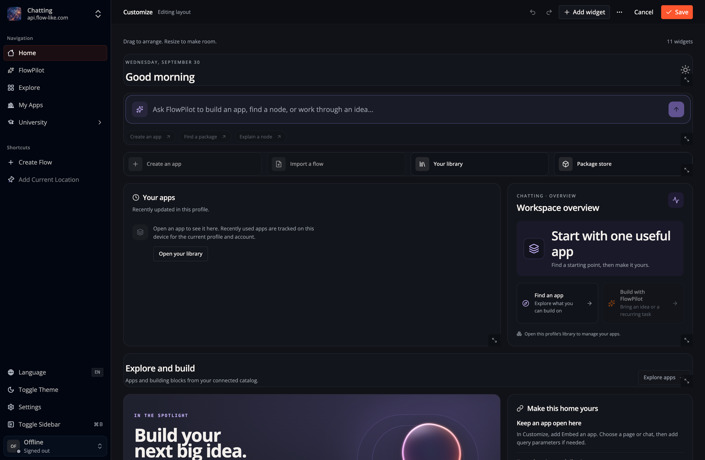
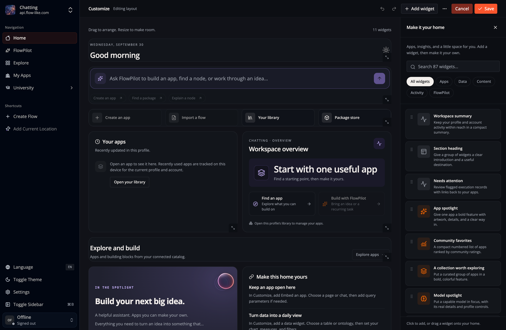

Home brings your bots, conversations, Apps, workspace activity, and discovery
widgets into one page. Choose **Customize** to add widgets, change their
content, or arrange them for the active Profile. Web and desktop use the same
editor.

## Save a personal layout

1. Select the Profile whose Home you want to change.
2. Open **Customize**, then **Add widget** to choose a widget. Select an existing
   widget to edit its content, data source, size, or appearance.
3. Drag widgets into position. With the keyboard, pick up a widget using its
   move handle, use the arrow keys to choose a position, and press Space to
   place it. Escape cancels the move or an active pointer resize.
4. Choose **Save** to apply the layout. **Cancel** lets you discard unsaved
   changes. Undo and redo are available while editing.

Finish an active move or resize before saving. If a save fails, the editor
retains the draft so you can retry.

The widget library groups available widgets by purpose. Use its search field
or a category such as **Bots**, **Apps**, **Data**, or **Content** to find one
to add.

## Talk to your bots from Home

The starter Home opens with your bots. The **Bots** category holds these
widgets:

- **Talk to your bots**: write a message and choose who gets it, the Assistant,
  Flux, or any bot in your crew. Sending opens that bot's chat in the Bots tab
  and sends the message there. **Message a bot** is the same composer as a
  slim bar. In its settings, choose which bot it talks to first.
- **Your crew**: your bots as cards. Select one to open its chat, or choose
  **New bot** to create one without leaving Home.
- **Messages**: your newest conversations with people and bots. Approvals,
  invitations and bot messages waiting for your answer are pinned on top, and
  you can accept or decline an invitation right there.
- **Rooms**: your group chats with their members. Start a new room or message
  from the widget.
- **Needs you**: only what waits for your answer.

**Messages** can also show only unread conversations or only direct messages.
A conversation you pin with **Pin to top** in its **⋯** menu stays first in
Messages, Rooms and the Bots tab, and only you see your pins. Inside a chat, a
message's menu stars it for you or pins it for everyone in the conversation.
**Starred** in the Bots tab lists your starred messages.
Messages, rooms and invitations need an account. On the desktop, conversations
with bots on this computer also show while you are signed out.

## Schedule a meeting from a room

Open an account room and select **Meetings**, then **Schedule meeting**. Enter
a title and start and end times. The form shows your local time zone. Enable
**Allow guests** to invite people outside the room, including people without
a Flow-Like account.
After scheduling, copy the meeting link or use **Add to calendar** to download
a calendar event.

Room members join with their accounts. A guest opens the invitation link in a
browser, enters a name, and waits for the host to select **Admit**. Meeting
chat and media are separate from the room, so guests cannot read its history
or use its bots. **Replace guest link** invalidates the previous link for new
join requests.

Joining opens 15 minutes before the start time. Select **Join audio and video**
to start your microphone, then use the call controls to turn on your camera
or share a screen. Camera and screen sharing can run together. The browser
asks which screen, window, or tab to share. If screen sharing is unavailable
in your app, open the meeting in a browser that supports it.

Calls support up to eight people, including the host. The app stops media when
you leave, the scheduled time ends, or the host removes you. The host can also
select **End meeting for everyone**. If the app cannot confirm your access,
it stops media until you reconnect and join the call again.

## Add an image

In **Customize → Add widget → Content**, choose **Image and caption**. In its
settings, choose an **Image source**:

- **URL**: enter an HTTP(S) image URL or a path on the current site.
- **App storage**: choose an App, browse its shared storage folders, and select
  an image. Viewers need permission to read that App's files.

Add an **Image description** for people using a screen reader. You can also add
a caption in **Content**. Editorial stories and banners support the same image
sources.

Storage images keep their App and file path in the layout. Home obtains a
temporary download URL through the App's storage API and refreshes it before
it expires. Your browser caches the image according to the storage provider's
HTTP cache settings. If a storage image fails to load, check your connection and
file permissions, then choose **Try again**.

## Understand defaults

Home uses the first available layout in this order:

1. Your saved personal layout for the active Profile.
2. The published default assigned to that Profile.
3. The installation's published main default.
4. The starter bundled with Flow-Like.

A personal layout takes precedence over later changes to published defaults.
To return to inherited defaults, open **Customize → Layout options → Reset to
default**, confirm the reset, then save. You can undo the reset before saving.

To start from the current bundled design instead, choose **Use Flow-Like
starter** in the same menu. This loads an editable draft. It does not change
your saved layout until you save, and it does not publish an installation-wide
default. Administrators manage shared defaults separately; see
[Publish default Home layouts](/self-hosting/administration/home-layouts/).

When you use an inherited layout and its published default cannot be loaded,
Home uses its last available cached default or the bundled starter. A failure to
load the Profile itself shows a retry action. Check that the intended Profile is
active before retrying a save.

## Size widgets for their content

**Match row** aligns a widget's surface with its neighbors. **Fit content**
keeps its natural height. Choose a row count or resize the widget when you need
a fixed height. On narrow screens, widgets form a single column.

The widget's **surface** controls its frame and accent. Collection **card
style** controls how the Apps, models, or packages inside it are displayed.
These are separate choices. For manual App collections, you can reorder and
remove selected Apps; automatic collection filters do not override that manual
selection.

Embedded Apps keep their own page navigation and query parameters. Their
preview pauses while you edit Home. Account activity widgets report the
available account execution records; an unavailable data source should be
retried rather than interpreted as zero activity.

## Customize appearance further

For Tailwind classes, scoped CSS, animation, theme variables, and selectors,
see [Home widget styling](/reference/home-styling/). Start with the built-in
surface and accent controls, then add custom styling where the layout needs it.
