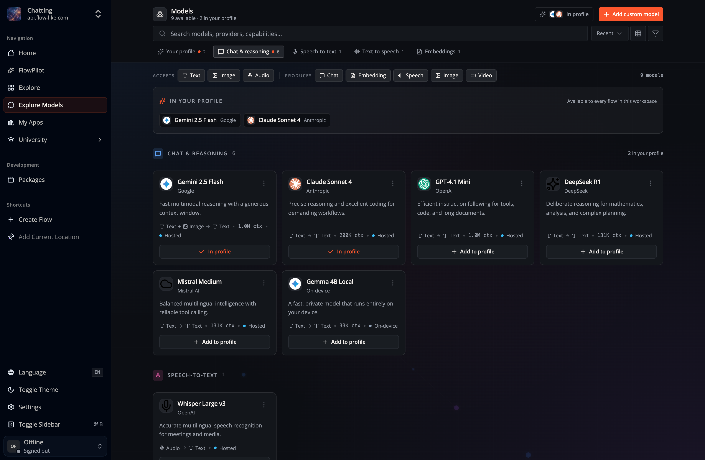
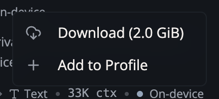

Open **Settings → AI Models** to browse language, vision, embedding, and decision
models. With [Developer Mode](/start/developer-mode/) enabled, **Explore Models**
in the sidebar opens the same catalog:



Downloading a model makes its files available on the current device. Assigning
it to a [Profile](/start/profiles/) makes it available to the Profile's AI
features and to compatible nodes in Studio.

For a local model, open the model card's menu and select **Download** if its
files are not present, then select **Add to Profile**. Hosted models do not
need a local model download. The catalog shows which models are already in
your Profile and whether a download or update is still in progress.



Local models use disk space and execute on supported local hardware. Hosted
models and provider-backed models can instead require a configured provider or
account. The exact models shown depend on the current catalog and Profile.

Once assigned, select the model from compatible nodes in
[Studio](/studio/overview/) or from FlowPilot's model picker.

## Custom API request parameters

For a custom HTTP chat or decision model, open **Connection → Advanced options**
and enter a JSON object in **Request parameters**. Use the provider's native API
field names. For example, an Anthropic model can set its output limit with:

```json
{
  "max_tokens": 8192
}
```

The Bit stores this object at `parameters.provider.params.request_params`.
Its values override fields generated by FlowPilot or a flow after the provider
SDK builds the request. Nested objects merge, while arrays, scalar values, and
`null` replace the existing value. This lets you add new API fields without
waiting for an SDK update. The provider still validates the resulting request.

Save the Bit before starting a new run to use the new parameters. Keep
credentials in the connection fields and custom headers. The app controls
streaming mode, so `stream` cannot be set here. Downloaded local models,
embedding models, and subscription or CLI connections do not use these request
parameters.

## Decision models

The **Decisions** category contains SystemOne models for classification,
scoring, and yes/no assessments. Connect **Find Decision Model** or **Load Bit**
to **SystemOne Choice**, **SystemOne Score**, or **SystemOne Noul** in Studio.
**Find Decision Model** selects an available model from the active Profile.
**Invoke SystemOne** asks
several named questions together. These models return typed answers and
probabilities and do not appear in chat model pickers. Device deployments also
require the model in the project's manifest dependencies; selecting a profile
model alone does not package it. See [Decision models](/topics/genai/models/#decision-models).
