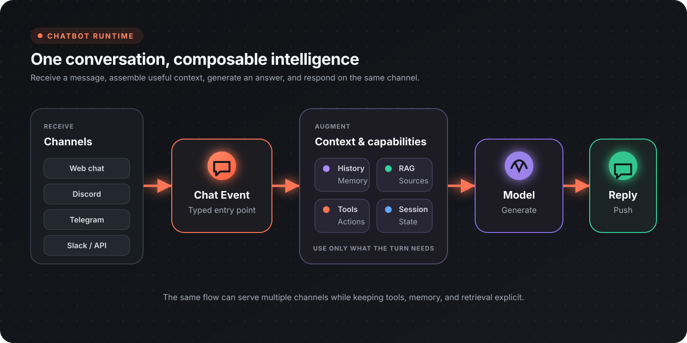

Flow-Like chat workflows can combine conversation history, retrieval, tools, and model responses. Design the bot as a controlled workflow: accept an event, assemble the allowed context, perform bounded work, return a response, and record enough information to evaluate the result.

## Choose a chatbot pattern

| Pattern | Best for | Main control |
|---------|----------|--------------|
| Prompted assistant | Drafting, explanation, simple Q&A | System instructions and model settings |
| Retrieval assistant | Answers grounded in a document collection | Search quality and citation policy |
| Tool-using agent | Looking up or changing external state | Tool permissions and confirmation |
| Guided conversation | Intake, troubleshooting, approvals | Explicit state and structured interactions |
| Notification bot | Proactive updates in a channel | Event filtering and delivery rules |

Start with the least autonomous pattern that completes the task. Add retrieval or tools only when the user need justifies the additional data and permissions.

## Core chat workflow

| Stage | Relevant nodes or design work |
|-------|-------------------------------|
| Receive | [Chat Event](/nodes/events/events-chat/) |
| Build history | [Make History](/nodes/ai/generative/history/ai-generative-make-history/), [Push Message](/nodes/ai/generative/history/ai-generative-add-history-message/) |
| Set instructions | [Set System Message](/nodes/ai/generative/history/ai-generative-set-system-prompt-message/) |
| Invoke | [Invoke Model](/nodes/ai/generative/ai-generative-invoke/) or an agent invocation |
| Return | [Push Response](/nodes/events/chat/events-chat-push-response/) |
| Stream | [Push Chunk](/nodes/events/chat/events-chat-push-response-chunk/) |

The system instructions should define the bot's role, allowed sources, tool policy, refusal behavior, and response shape. Keep them versioned with the Flow so changes can be tied to evaluation results.

## Conversation history

Only include history that helps the current turn. Long, unbounded transcripts increase latency and can distract the model from current instructions.

Use one of these approaches:

- retain the most recent turns;
- summarize older turns into a compact memory record;
- preserve durable facts separately from conversational text;
- clear history when the task or user context changes;
- keep private session data scoped to the correct user or conversation.

History nodes include [Set History N](/nodes/ai/generative/history/ai-generative-set-history-n/), [Pop Message from History](/nodes/ai/generative/history/ai-generative-pop-history-message/), and [Clear History](/nodes/ai/generative/history/ai-generative-clear-history/).

## Change a bot's settings in chat

For bots running in the desktop client or on the server, ask your bot to change its name, description, system instructions, capabilities, or model mappings. It can inspect its own settings even when a requested capability is switched off. If a model mapping is missing, the bot can recommend a compatible model from your profile. Review the proposed values and approve each change before it is saved. Auto mode and earlier approvals do not skip this review. Saved changes apply from the next turn; host restrictions and Flux's fixed capabilities still apply. Other conversation participants cannot change your bot's settings through these tools. Bots on managed devices use the bot editor for these changes.

## Configure a bot's decision model

In the built-in bot editor, choose an optional **Decision model (System One)** under **Instructions and models**. This model selects from bounded choices before the bot spends time on a full response. Server and managed-device bots require a hosted System One Bit. Desktop bots can also use a compatible local or configured provider.

In a group, the decision model can answer now, stay silent, or wait for a named participant. The host saves that wait across restarts and reevaluates it when the participant speaks. A direct request can interrupt the wait. During a call, the model can also choose a brief spoken acknowledgment. Acknowledgments do not run tools or update memory, and cannot start a chain of bot replies.

The same model ranks approved skills before the skill index reaches its prompt limit. When memory is enabled, it also helps decide whether a candidate fact adds useful information, repeats an existing fact, replaces an older fact, or should be discarded. Explicit requests to save a memory retain the information. These choices do not expand tool permissions or bypass approvals.

For incoming email and webhook events, the model can ignore an unnecessary event, process it quietly, reply in the conversation, or alert the owner. Execution errors and approval requests remain visible. To use this behavior for a scheduled check, enable **Only report meaningful changes** when creating the task. The bot performs the check first, then evaluates its result. Leave this option off for reminders and regular reports.

Leaving the decision model disabled keeps the existing response rules. If a decision model is unavailable, skill ranking, event handling, and memory curation fall back to their existing paths; a scheduled check still runs and reports its result.

## Choose what a group bot can remember

In the built-in bot chat, each bot has three memory switches for each group. Its owner chooses them during group setup or when accepting an invitation, and can change them later from the group's member list.

| Switch | Effect |
|--------|--------|
| **Use 1:1 memory** | Lets the group recall knowledge saved in the owner's private chat with this bot. That knowledge may appear in group answers. |
| **Use shared memory** | Lets the group recall knowledge from this bot's other groups that contribute to shared memory. |
| **Contribute to shared memory** | Makes this group's saved knowledge available in the owner's 1:1 and other groups that enable **Use shared memory**. |

All three switches start off. With those defaults, the bot learns and recalls knowledge within the group. The owner's 1:1 can always recall knowledge from contributing groups. These choices apply to the whole group memory, including knowledge already saved, without settings on individual memories.

Changes apply from the bot's next turn. Turning contribution off, or removing the bot from the source group, stops future recall from that group elsewhere. It does not erase answers the bot has already sent. The bot's overall memory setting must also be enabled for it to save and recall knowledge.

## Share current user context

Enable **User context** in a bot's capabilities to let it ask a person in its current conversation for location, timezone, language and units, personal preferences, availability, calendar free/busy, current Flow-Like activity, or device input capabilities. The capability starts off. Each person decides what to share; the bot's owner cannot approve another participant's information.

The request card names the bot, the requested fields, and the purpose. Choose **Share once**, **Allow for this session**, or **Decline**. Session access lasts up to 30 minutes in the same client and applies only to the same bot, person, purpose, fields, precision, and conversation audience. The card includes a revoke control. A changed audience requires fresh consent.

Context comes from the client where the person accepts the request. Location defaults to approximate coordinates; precise location is a separate request and still depends on operating-system permission. A person can enter a place manually when device location is unavailable. Requests expire after five minutes. The bot receives the snapshot only for the response turn and does not save that turn into automatic memory. The exchange and the bot's answer remain in the conversation.

Group requests share with the current group. Use a direct conversation to share privately with a bot. User context currently works in plain Flow-Like conversations; encrypted conversations and external messaging channels do not offer these request cards.

Your account's availability controls let you set **Available**, **Busy**, **Focus**, or **Away** for up to four hours, with one hour selected initially. Other people see this status beside your identity. Busy and Away set expectations. Focus silences routine Flow-Like alerts while keeping messages and notifications in the inbox. You can choose whether direct mentions and incoming calls may interrupt Focus. These settings control Flow-Like notifications; operating-system Focus settings remain separate.

A bot can propose a timed status through `user_context_set_status`. The affected person approves the exact status and duration, or declines. Session permission to read context cannot approve a status change. The four-hour limit is checked by the client and server, and the status expires without requiring the bot to run again.

In a local-only conversation, an approved status applies to the current app session and its foreground alerts. Account settings show this device status with a separate clear control. Shared presence and server push preferences belong to your signed-in account.

Link Google Calendar or Microsoft Outlook from the availability settings to derive free/busy from your primary calendar. Each connection belongs to your own account. Flow-Like reads busy time ranges for the next 24 hours, refreshes them as you use the app, and expires cached calendar information after five minutes. Event titles, descriptions, and attendees are excluded from shared context. Manual and approved bot-set statuses take priority until they expire; clearing the override returns to calendar availability. Unlinking a calendar removes it from availability without disconnecting its other uses in Flow-Like.

## Give memories a place and time

With memory enabled, a bot can save a location as `geojson`, an event time as `time`, and a lifetime as `ttl_seconds`. All are optional. GeoJSON coordinates use longitude before latitude. Event times use RFC 3339 timestamps with an offset, independently of when the bot learned the fact. An explicit save starts the TTL when the bot saves the fact and produces an `expires_at` timestamp. Automatic extraction starts it at the supporting message's time, so reading older evidence cannot renew retention. Repeating a saved fact preserves its expiry. Expiry immediately excludes the fact from recall and memory listings. Background maintenance deletes expired rows and their vectors, then prunes old fact-table versions. The original conversation remains, and expiry does not create a reminder.

The bot's `memory_search` tool accepts `sort: "distance"` with a GeoJSON Point, an optional `radius_m`, or an `area` Polygon or MultiPolygon. Area searches include intersecting geometry and polygon boundaries while respecting holes. For dates, use `sort: "time_asc"` or `"time_desc"` and an optional `timeframe` with inclusive `from` and exclusive `to` timestamps. `time_range` also accepts phrases such as `last week`. An empty `query` searches by these fields alone. Existing memory tables gain the optional columns automatically, and older facts keep their existing date behavior.

When a conversation leaves a concrete future follow-up, bots with scheduling enabled are guided to create a one-time task using `schedule_task`, after checking for an existing task. The task carries the follow-up context and runs at the chosen time. Recurring tasks remain appropriate for repeated work. Memory expiry and scheduled follow-ups are separate controls.

Memory maintenance runs in the background after a turn when it is first needed and then every six hours while the conversation is active. An inactive conversation waits for its next turn. The host records the last successful run, retries failures on later turns, and holds a renewable lease during storage changes. Maintenance repairs missing embeddings, compacts LanceDB files, updates indexes, and removes ordinary table versions older than seven days. Hash-only expiry markers prevent old evidence from recreating deleted facts; resetting memory removes those markers too.

Full-text indexes serve keyword search. B-tree indexes support identifiers, timestamps, expiry, and other selective filters; bitmap indexes support categories such as fact kind. Facts and summaries gain cosine `IVF_FLAT` vector indexes once they have at least 256 vectors from the current embedding model. Smaller tables use exact vector scans. Area queries use an R-tree on a derived geometry column. Older memories gain this geometry automatically on their first area query or during maintenance. Radius filtering and distance sorting still compute exact spherical distances over eligible facts. Structured searches bypass approximate vector search so geographic or chronological ordering cannot miss an eligible result.

## Ground responses with retrieval

Use retrieval when the bot must answer from a controlled corpus rather than general model knowledge.

1. ingest documents and preserve source metadata;
2. split content into retrieval-sized chunks;
3. embed and store each chunk;
4. embed the user's query;
5. retrieve relevant chunks;
6. pass only the useful context to the model;
7. return source references with the answer;
8. decline or ask for clarification when retrieval is insufficient.

See [Retrieval-Augmented Generation](/topics/genai/rag/) for the full indexing and query workflow.

## Add tools

For multi-step or external operations, build an agent and register only the tools it needs.

| Need | Node |
|------|------|
| Build from a configured model | [Agent from Model](/nodes/ai/agents/builder/agent-from-model/) |
| Set agent instructions | [Set Agent System Prompt](/nodes/ai/agents/builder/agent-set-system-prompt/) |
| Register Flow-Like functions | [Register Function Tools](/nodes/ai/agents/builder/agent-register-function-tools/) |
| Register MCP tools | [Register MCP Tools](/nodes/ai/agents/builder/agent-register-mcp-tools/) |
| Invoke | [Invoke Agent](/nodes/ai/agents/agent-invoke/) |
| Stream | [Stream Invoke Agent](/nodes/ai/agents/agent-stream-invoke/) |

Separate read tools from write tools. Ask for confirmation before destructive, costly, or externally visible actions. Validate tool arguments in the workflow even if the model produced them.

## Give a bot a longer task

Bots in the built-in bot chat can work through research, coding, browser, and computer tasks over many tool rounds. Describe the outcome and how to check it. The bot can keep a work plan with completed steps, evidence, blockers, and a checkpoint for the next action. Progress appears in the existing chat activity. A progress reply can be followed by more work while the plan remains active.

The runtime summarizes older tool exchanges as context grows and keeps recent observations. The work plan and original request remain available after compaction. A bot with **Delegation** can assign independent parts to isolated subtasks and inspect their results. Browser and computer subtasks sharing a turn take turns using the interactive session; independent research can run alongside them. Subtasks keep the parent's permission limits and cannot request approvals themselves.

A bot turn allows up to 128 tool rounds, followed by a closing answer. Each subtask allows 64 rounds and up to 15 minutes, within the parent's shared time budget. Native and self-hosted background hosts default to 30 minutes per turn; hosted Lambda workers keep a 10-minute cap. Account budgets, caller deadlines, and operating-system suspension can stop work sooner. Cancelling stops further execution but cannot undo completed actions.

Built-in bot turns save execution checkpoints in their host's turn store. After a process restart, the host reclaims unfinished work and restores the saved context, plan, and remaining round budget. A saved final answer can be delivered without running its tools again. Recovery keeps the original deadline; restarting does not grant more execution time. Explicitly cancelled turns stay cancelled.

The host records tool calls before execution and saves their results as they finish. If a crash leaves a call's outcome unknown, the bot stops with an unfinished-work report instead of repeating an action that might already have happened. Calls paused for approval are recorded as unexecuted and can continue after the owner answers. Browser and computer observations must be refreshed after a restart. Checkpoints for encrypted conversations remain encrypted to the bot's keys, which the recovering host must still hold.

Recovery applies to the built-in bot tool loop. Scheduled tasks still start separate runs, and the bot's memory setting governs what it can recall in later tasks. Agent nodes in a workflow and external coding-agent backends use their own execution and recovery mechanisms.

## Stream useful progress

Streaming improves perceived latency, but it should not expose raw internal reasoning or unvalidated tool output.

- stream user-facing response chunks with **Push Chunk**;
- use [Push Step](/nodes/events/chat/events-chat-push-step/) for named progress stages;
- use [Push Stats](/nodes/events/chat/events-chat-push-stats/) for safe, structured status data;
- finish with a complete response or an explicit error state.

If the workflow fails after partial output, tell the user that the operation did not complete. Do not let a partial success message imply that a side effect happened.

## Attachments

Chat events can work with attachments, and responses can include attachments from paths or signed URLs:

- [Extract Attachments](/nodes/events/chat/ai-gen-llm-history-extract-attachments/)
- [From Path](/nodes/events/chat/attachments/events-chat-attachment-from-path/)
- [From Signed URL](/nodes/events/chat/attachments/events-chat-attachment-from-signed-url/)
- [Push Attachment](/nodes/events/chat/events-chat-push-attachment/)

Validate type and size before processing uploads. Do not automatically pass every attachment to a model; select the minimum content needed for the task.

## Structured interactions

Use interaction nodes when free-form text would make a task ambiguous:

| Interaction | Node |
|-------------|------|
| Form | [Chat Form](/nodes/events/chat/interaction/interaction-form/) |
| One choice | [Single Choice](/nodes/events/chat/interaction/interaction-single-choice/) |
| Multiple choices | [Multiple Choice](/nodes/events/chat/interaction/interaction-multiple-choice/) |

Structured interactions are useful for approvals, configuration, and collecting required fields before a tool runs.

## Channels

The same conversational logic can be connected to the Flow-Like app chat surface or to supported provider-specific messaging nodes. Keep channel transport separate from the core response workflow:

- normalize incoming identity, message text, and attachments;
- call the shared bot workflow;
- adapt the result to the channel's formatting and size limits;
- store channel-specific delivery identifiers outside the model prompt.

Search the [node catalog](/nodes/overview/) for current provider coverage.

## Safety and privacy

- Treat retrieved documents, web content, and tool output as untrusted data rather than instructions.
- Restrict tools and credentials to the minimum required scope.
- Require confirmation for destructive or externally visible actions.
- Redact secrets and personal data from traces and error messages.
- Make uncertainty visible; do not invent a source or claim that a tool succeeded.
- Keep tenant, user, and conversation state isolated.
- Define retention for transcripts, uploaded files, and retrieved context.

## Evaluate the bot

Maintain a representative test set for:

- common successful requests;
- ambiguous or incomplete requests;
- no-result retrieval queries;
- prompt-injection attempts in user and retrieved content;
- tool failures and timeouts;
- confirmation-required actions;
- long conversations and history truncation;
- attachment type and size limits.

Track answer correctness, source grounding, tool success, latency, cost, and escalation or refusal quality. Review traces by failure category instead of relying only on an average score.

## Meter usage and set monthly budgets

For an account bot, open **Details → Usage & limits** to see its hosted model calls, token counts, and monthly spending. In a group's member list, open the bot's usage to inspect the part attributed to that conversation. Group members can read that group's usage; the bot's owner controls its budget.

Owners can set monthly limits for hosted AI spending, model calls, and cloud runtime. A blank field inherits the applicable ceiling; zero prevents further consumption of that resource. A group budget applies to one bot in that group. The bot's total budget also covers its work in other groups and direct chats. Account quotas and existing app limits continue to apply alongside these budgets.

Enterprise administrators set default app and bot ceilings in the admin usage view. These defaults apply to existing and new resources unless an administrator saves an individual override. Owners can lower their limits, but an administrator must approve a ceiling above the default. Removing an admin override restores the current default. App owners can inspect their budget on the project dashboard.

Budget windows start on the first day of each month at 00:00 UTC. Before starting hosted work, the API reserves capacity against each applicable budget. Pending work counts toward the limit until its usage settles or its reservation is released. Reducing a limit does not cancel work already admitted. The usage view shows spent and reserved amounts separately.

Budget spending uses euros and includes the hosted service's accounting costs. The model breakdown reports provider costs in US dollars and separates input, output, and embedding tokens. These totals have different purposes and should not be compared as the same price.

Metering starts when this feature is deployed. Historical calls do not gain bot or group attribution retroactively. Direct calls to local models, command-line providers, or a provider using your own key do not pass through the enterprise model API, so their provider usage is outside these hosted budgets. Locally stored bots also need an account identity before their usage can appear in the enterprise overview.

## Production checklist

- [ ] System instructions and model settings are versioned
- [ ] History is bounded and scoped to the correct session
- [ ] Retrieval preserves source references
- [ ] Tool permissions are minimal
- [ ] Write actions have validation and confirmation
- [ ] Streaming has a clear completion and failure state
- [ ] Uploads are validated before processing
- [ ] Test cases cover failures and adversarial input
- [ ] Logs and traces redact sensitive data

## Next steps

- [Retrieval-Augmented Generation](/topics/genai/rag/)
- [Agents](/topics/genai/agents/)
- [Prompt templates](/topics/genai/prompt-templates/)
- [API integrations](/topics/api-integrations/overview/)
